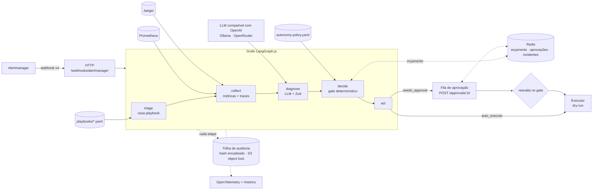

# ops-copilot


Copiloto de operações (AI-Ops) que investiga incidentes dos serviços do portfólio e propõe ações dentro de **limites de autonomia definidos em código**, nunca no prompt.

## O problema

Três sistemas fictícios rodam em produção e acordam o plantão com os mesmos tipos de alerta:

| Serviço | Domínio | Alerta típico |
| --- | --- | --- |
| `payments-events-go` | Processador de eventos de um provedor de pagamentos | Mensagens acumulando na DLQ |
| `kafka-telemetry` | Pipeline de leituras dos sensores de estufas agrícolas | Lag crescente do consumidor |
| `saas-multitenant` | SaaS de agendamento para estúdios de yoga e pilates | Latência p99 alta na API |

Hoje, a cada alerta, alguém abre o Prometheus, procura traces no Jaeger, compara com o runbook e decide o que fazer. Os primeiros 15 minutos são quase sempre iguais. Às vezes a decisão é óbvia e reversível (desligar a exportação pesada de relatórios de um estúdio que está derrubando a API para todos). Às vezes ela mexe com dinheiro e precisa de uma pessoa (reprocessar a DLQ de pagamentos).

O ops-copilot faz esses 15 minutos sozinho: recebe o alerta, coleta métricas e traces, diagnostica com um LLM guiado por um playbook versionado e propõe uma ação. Quem decide se a ação roda sozinha, pede aprovação, vira sugestão ou é bloqueada é um **gate determinístico**, testado e configurado por serviço.

## Arquitetura



| Etapa | O que faz | LLM? |
| --- | --- | --- |
| `triage` | Casa `alertname` + `service` com um playbook. Sem playbook, encerra (`no_playbook`). | Não |
| `collect` | Roda as consultas PromQL e as buscas no Jaeger do playbook, em paralelo. Fonte fora do ar vira sinal de erro. | Não |
| `diagnose` | Pede ao LLM uma hipótese, evidências e uma ação, tudo dentro de enums do playbook. Valida com Zod, faz um retry e depois falha explicitamente. | Sim |
| `decide` | Gate: catálogo, allowlist, playbook × hipótese, limites de parâmetros, nível efetivo, reversibilidade, confiança e orçamento. | Não |
| `act` | Executa em dry-run, abre pedido de aprovação com prazo, ou só registra. | Não |

## Como rodar

Pré-requisitos: Node 22, pnpm 12 e Docker.

```bash
cp .env.example .env
pnpm install
make up          # copiloto + Redis + MinIO + Prometheus/Alertmanager/Jaeger com dados sintéticos
make seed        # dispara um alerta de exemplo (SCENARIO=saas|payments|telemetry)
make logs        # acompanha a investigação
make audit       # lista a trilha de auditoria no MinIO
```

- Prometheus: http://localhost:9090 (os alertas sintéticos disparam e se resolvem sozinhos a cada poucos minutos)
- Jaeger: http://localhost:16686 (traces sintéticos dos três serviços e do próprio copiloto)
- Console do MinIO: http://localhost:9001
- Se alguma porta estiver em uso, mude-a no `.env` (`COPILOT_PORT`, `PROMETHEUS_PORT` etc.).

**LLM.** Por padrão o copiloto usa um Ollama no host (`ollama pull qwen2.5:7b-instruct`). Para usar o OpenRouter, defina `LLM_PROVIDER=openrouter`, `OPENROUTER_API_KEY` e as URLs no `.env`. Sem LLM disponível, a investigação termina em `diagnosis_failed`, que é explícito e auditado.

**Modo ecossistema.** `make up-portfolio` cria a rede `portfolio-net` e sobe só o núcleo, observando o Prometheus e o Jaeger dos outros projetos (`PORTFOLIO_PROMETHEUS_URL` e `PORTFOLIO_JAEGER_URL`).

**Operadores e aprovação humana.** Cada pessoa tem um token (`OPERATOR_TOKENS`, ADR 0012) ou entra por OIDC; a identidade vem da credencial e assina a trilha. Recusar e cancelar exigem motivo (ADR 0013).

```bash
TOKEN=dev-only-operador-plantao   # plantonista@example.com no .env.example
curl -s localhost:8080/approvals -H "Authorization: Bearer $TOKEN"
curl -s -X POST localhost:8080/approvals/<id> -H "Authorization: Bearer $TOKEN" \
  -H 'Content-Type: application/json' -d '{"decision":"reject","reason":"fora da janela de mudança"}'
curl -s -X POST localhost:8080/incidents/<id>/cancel -H "Authorization: Bearer $TOKEN" \
  -H 'Content-Type: application/json' -d '{"reason":"alerta falso positivo"}'
```

**Leituras** (mesma credencial): `/incidents`, `/incidents/:id`, `/audit`, `/audit/verify`, `/policy`, `/playbooks`, `/budget`, `/me`; `/config` é público.

Para desenvolver no host: `make dev` (usa o `.env`). Sem `REDIS_URL`, o estado fica em memória.

## Como testar

```bash
make test              # lint + typecheck + testes unitários + evals com modelo falso
make test-integration  # contra Prometheus, Jaeger, MinIO e Redis do compose (rode make up antes)
pnpm eval --model real # evals com o LLM do .env (manual; custa tokens)
```

- **Nenhum teste chama LLM real.** O `FakeLlmClient` responde de forma roteirizada.
- `tests/autonomy/gate.test.ts` prova que ações fora do limite são bloqueadas: ação desconhecida, fora da allowlist, fora do playbook, hipótese errada, parâmetros fora dos limites, serviço somente leitura, kill switch, orçamento esgotado e ação irreversível.
- `tests/graph/investigation.test.ts` roda o grafo de ponta a ponta, incluindo injeção de prompt no alerta, falha de schema, falha do executor e spans OpenTelemetry.
- Os testes de integração provam, no MinIO real, que a trilha de auditoria não pode ser sobrescrita nem apagada.

## Interface

O painel **Vigília** (`web/`, Vue 3 + Vuetify 3 + TanStack Query) é o caderno de bordo do plantão: tema escuro por padrão, rail de 48 px, atalhos de teclado e paleta de comandos `⌘K`. O âmbar aparece só onde uma pessoa precisa decidir. O elemento-assinatura é a **fita do gate**: cada incidente é uma fita com as cinco etapas, e na etapa `decide` o carimbo lista as checagens passadas (✓) e falhadas (✕) do gate. A trilha de auditoria mostra os **elos de hash**.


| Tela | O que mostra |
| --- | --- |
| Incidentes | Serviços monitorados, lista com etapa, veredicto e estado; pendentes sobem com contagem regressiva |
| Investigação | Fita do gate, hipótese, evidências (PromQL, sparklines, traces, fontes com erro) e a decisão humana |
| Aprovações | Fila com prazo, por que precisa de humano e o que acontece se vencer; aprovar, recusar com motivo, cancelar |
| Auditoria | Registros com ator, evento e elo de hash; botão "verificar cadeia" |
| Política, playbooks | Matriz serviço × ação com limites de parâmetros, arquivo de origem e commit (só leitura) |
| Orçamento | Saldo de ações automáticas por serviço e consumo do LLM |

Como rodar:

```bash
make up                 # sobe tudo, inclusive o painel em http://localhost:8088 (WEB_PORT)
make web-dev            # só o painel, com Vite em http://localhost:5173 (proxy /api para localhost:8080)
make web-test           # lint, typecheck, testes e build do painel
```

Entre com o token de operador do `.env` (`dev-only-operador-plantao`, em `OPERATOR_TOKENS`) ou, se o copiloto tiver `OIDC_ISSUER_URL`, com OIDC (ADR 0012).

## Decisões principais

| ADR | Decisão |
| --- | --- |
| [0001](docs/adr/0001-langgraph-js-em-vez-de-crewai.md) | LangGraph.js com etapas fixas, em vez de CrewAI |
| [0002](docs/adr/0002-limites-de-autonomia-como-codigo.md) | Limites de autonomia como código determinístico, nunca como prompt |
| [0003](docs/adr/0003-playbooks-versionados-em-yaml.md) | Playbooks versionados em YAML, validados por schema |
| [0004](docs/adr/0004-cliente-llm-compativel-com-openai.md) | Cliente LLM compatível com OpenAI, com modelo falso nos testes |
| [0005](docs/adr/0005-saida-do-llm-validada-por-zod.md) | Saída do LLM validada por Zod, com um retry |
| [0006](docs/adr/0006-executor-em-dry-run-por-padrao.md) | Executor em dry-run por padrão |
| [0007](docs/adr/0007-trilha-de-auditoria-encadeada-por-hash.md) | Trilha de auditoria encadeada por hash |
| [0008](docs/adr/0008-evals-com-modelo-falso-no-ci.md) | Evals com modelo falso no CI e real sob demanda |
| [0009](docs/adr/0009-sem-playbook-sem-llm.md) | Alerta sem playbook não é investigado pelo LLM |
| [0010](docs/adr/0010-auditoria-em-s3-com-object-lock.md) | Trilha de auditoria em S3 com object lock (MinIO local) |
| [0011](docs/adr/0011-estado-operacional-no-redis.md) | Orçamento, aprovações e incidentes no Redis, com falha fechada |
| [0012](docs/adr/0012-autenticacao-de-operador.md) | Autenticação de operador: token de dev ou OIDC opcional |
| [0013](docs/adr/0013-decisao-humana-aprovar-recusar-cancelar.md) | Aprovar, recusar com motivo e cancelar, com a identidade de quem decidiu |

Para defender o núcleo numa entrevista: [roteiro dos limites de autonomia](docs/roteiros/limites-de-autonomia.md) e [roteiro dos playbooks](docs/roteiros/playbooks.md). O desenho completo está no [design doc](docs/design-doc.md).

## Observabilidade do copiloto

- **Traces:** um span `ops_copilot.investigate` por incidente, um `ops_copilot.node.<etapa>` por etapa e um `gen_ai.chat` por chamada ao LLM, com `gen_ai.usage.input_tokens`, `gen_ai.usage.output_tokens` e `ops_copilot.llm.cost_usd`. A exportação é OTLP/HTTP (`OTEL_EXPORTER_OTLP_ENDPOINT`).
- **Métricas** em `/metrics`: `ops_copilot_incidents_total{service,outcome}`, `ops_copilot_decisions_total{service,action,verdict}`, `ops_copilot_llm_tokens_total`, `ops_copilot_llm_cost_usd_total`, `ops_copilot_llm_calls_total{result}`, `ops_copilot_signal_failures_total` e `ops_copilot_node_duration_seconds`.
- **Logs** JSON (pino) com `trace_id` e `span_id` para correlação. Cabeçalhos de autenticação e chaves são mascarados.

## Trade-offs

- **Previsibilidade em vez de flexibilidade:** etapas fixas e uma chamada ao LLM por incidente. O copiloto não "explora" livremente; incidentes sem playbook vão direto para humanos.
- **Playbook obrigatório:** cobertura cresce na velocidade com que os times escrevem playbooks. Em troca, toda ação tem dono, versão e revisão.
- **Estado operacional no Redis (ADR 0011):** orçamento, aprovações e incidentes sobrevivem a restart e valem para várias réplicas, ao custo de mais uma dependência. Sem Redis, o gate falha fechado.
- **Painel sem tempo real por push:** o painel reconsulta a API a cada 5 s (TanStack Query) em vez de manter WebSocket: mais simples e suficiente para a escala do plantão.
- **Dry-run por padrão:** o modo live (ADR 0014) existe, com allowlist de alvos, mas os adaptadores de Kubernetes, flags e DLQ só foram testados contra dublês e um emulador local da API; não foram exercitados contra cluster ou serviços reais.
- **Resumo de sinais, não dados brutos:** o prompt tem tamanho limitado e custo previsível, mas o modelo vê estatísticas e não a série completa.

## Próximos passos

- `notify_oncall` em modo live ainda não tem adaptador de notificação (falha explícita).
- Exercitar o executor real contra um cluster, um serviço de flags e uma DLQ de verdade.
- Aprovação via ChatOps (Slack/Teams), papéis separados (leitor e aprovador) e um teto de custo de LLM por incidente.
- RAG sobre runbooks em Markdown para enriquecer a orientação dos playbooks.
- Dataset de evals maior, com incidentes reais anonimizados, e comparação entre modelos (custo × acerto).
- Detecção preditiva com PromQL (`predict_linear`) para abrir investigação antes do alerta.
- Checkpoints do LangGraph para retomar investigações interrompidas.
