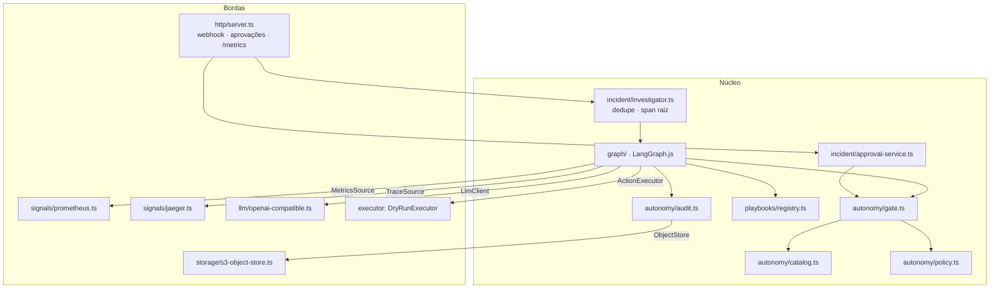
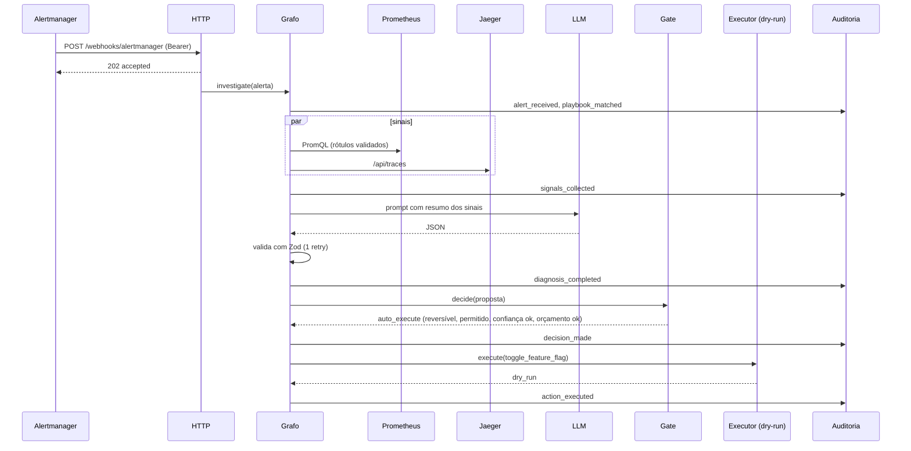
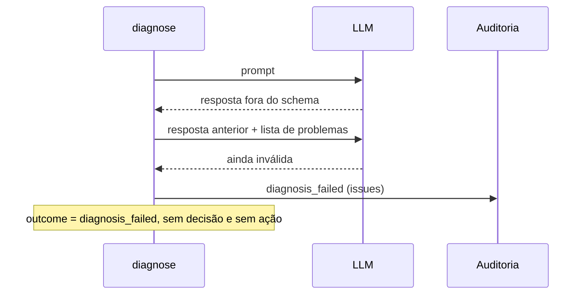

# Design doc: ops-copilot

- **Autor:** Johnny Santos
- **Status:** Fundação implementada (v0.1)
- **Última revisão:** 2026-11-21

## 1. Contexto

O portfólio tem três serviços em produção fictícia: `payments-events-go` (eventos de um provedor de pagamentos), `kafka-telemetry` (leituras de sensores de estufas agrícolas) e `saas-multitenant` (agendamento para estúdios de yoga e pilates). Os três expõem métricas no Prometheus e traces no Jaeger, e o Alertmanager avisa o plantão.

A investigação inicial de cada alerta é repetitiva: abrir dashboards, buscar traces, comparar com o runbook e escolher entre poucas ações conhecidas. Algumas ações são seguras e reversíveis (desligar uma funcionalidade degradável). Outras têm efeito irreversível (reprocessar pagamentos) ou destrutivo (pular offsets no Kafka).

O ops-copilot automatiza a investigação e propõe a ação. A tese central é que **o que o copiloto pode fazer sozinho é decidido por código determinístico e configuração revisada, e não pelo modelo**.

## 2. Objetivos e não-objetivos

**Objetivos**

1. Receber alertas do Alertmanager e investigar cada um com um playbook versionado.
2. Coletar sinais reais do Prometheus e do Jaeger, tolerando falhas parciais.
3. Diagnosticar com LLM, com saída validada por schema, e propor uma ação do playbook.
4. Aplicar limites de autonomia por serviço: allowlist, níveis, orçamento por janela, confiança mínima e reversibilidade.
5. Registrar cada etapa numa trilha de auditoria imutável.
6. Medir o acerto do diagnóstico com evals reproduzíveis.
7. Ser observável: traces, custo e tokens por investigação.

**Não-objetivos (nesta fundação)**

- Executar ações de verdade em clusters ou filas. O executor é dry-run (ADR 0006).
- Investigação livre de incidentes sem playbook (ADR 0009).
- Interface de chat. As aprovações são via HTTP, e ChatOps vem depois.
- Detecção de anomalias. O gatilho é sempre um alerta.

## 3. Arquitetura

Arquitetura hexagonal: o domínio (gate, playbooks, grafo) depende só de portas. Os adaptadores ficam nas bordas e são montados em `src/app.ts`.



| Pasta | Responsabilidade |
| --- | --- |
| `src/domain` | Payload do Alertmanager e alerta normalizado |
| `src/playbooks` | Schema, carga, casamento e renderização segura de consultas |
| `src/autonomy` | Níveis, catálogo de ações, política, orçamento, gate e auditoria |
| `src/llm` | Porta, adaptador compatível com OpenAI, modelo falso e saída estruturada |
| `src/signals` | Portas e adaptadores de Prometheus e Jaeger, resumo para o prompt |
| `src/graph` | Estado e etapas do grafo |
| `src/incident` | Caso de uso de investigação, prompt, schema do diagnóstico e aprovações |
| `src/executor` | Porta do executor e implementação dry-run |
| `src/storage` | Porta de armazenamento de objetos e adaptador S3 |
| `src/telemetry` | Tracing, métricas, logs e decorador do LLM |
| `src/http` | Servidor HTTP (somente `node:http`) |

## 4. Modelo de dados

**Playbook** (`playbooks/*.yaml`, ADR 0003)

```yaml
apiVersion: ops-copilot/v1
kind: Playbook
metadata: { id, version (semver), owner, description }
match: { alertname, service }
signals:
  metrics: [{ name, description, query (PromQL com {{rótulo}}), kind: instant|range, window, step }]
  traces:  [{ name, description, service, operation?, minDurationMs?, lookback, limit }]
diagnosis: { guidance, hypotheses: [{ id, description }] }
actions:   [{ action (id do catálogo), when: [hipóteses], params (fixos), rationale }]
autonomy:  { maxLevel, minConfidenceForAuto }
```

**Política de autonomia** (`config/autonomy-policy.yaml`)

```yaml
killSwitch: false
defaults: { level: read_only, budget: { window: 1h, maxAutoActions: 0 } }
services:
  <serviço>: { level, allowedActions: [...], budget?: { window, maxAutoActions } }
```

**Catálogo de ações** (código, `src/autonomy/catalog.ts`)

| Ação | Reversível | Teto de autonomia | Limites de parâmetros |
| --- | --- | --- | --- |
| `notify_oncall` | sim | auto | canal `#[a-z0-9-]` |
| `scale_deployment` | sim | auto | `replicasDelta` 1–2, `maxReplicas` ≤ 12 |
| `toggle_feature_flag` | sim | auto | só desligar (`enabled: false`) |
| `replay_dlq_batch` | não | aprovação | `maxMessages` ≤ 500 |
| `restart_pods` | não | aprovação | nome Kubernetes válido |
| `reset_consumer_offsets` | não | sugerir | `to: latest/earliest` |

**Diagnóstico** (saída do LLM, schema gerado por playbook)

```ts
{ hypothesisId: enum(hipóteses), confidence: 0..1, summary: string,
  evidence: [{ signal: enum(sinais coletados), observation }],
  proposedAction: { actionId: enum(ações do playbook), params, rationale } | null }
```

**Decisão** do gate: `{ verdict: blocked|suggest|needs_approval|auto_execute, effectiveLevel, action: { id, params finais, reversible } | null, reasons[] }`.

**Registro de auditoria:** `{ seq, at, incidentId, event, actor: copilot|human:<e-mail>, details, prevHash, hash }`.

**Estado do grafo:** `incidentId`, `alert`, `playbook`, `signals[]`, `diagnosis`, `decision`, `execution`, `approvalId`, `failure`, `outcome`, `llmUsage`.

## 5. Fluxos principais

### 5.1 Investigação com execução automática (saas-multitenant)



### 5.2 Ação que exige aprovação (payments-events-go)

```mermaid
sequenceDiagram
  participant G as Grafo
  participant GT as Gate
  participant Q as Fila de aprovação
  participant P as Plantonista
  participant S as ApprovalService
  participant E as Executor
  participant A as Auditoria
  G->>GT: decide(replay_dlq_batch)
  GT-->>G: needs_approval (irreversível; política exige aprovação)
  G->>Q: request (expira em 30 min)
  G->>A: approval_requested
  P->>S: POST /approvals/:id {approver, approve}
  S->>Q: take (uso único)
  S->>GT: authorizeApproved (reavalia com a política vigente)
  alt ainda permitido
    S->>A: approval_granted (human:e-mail)
    S->>E: execute
    S->>A: action_executed (human:e-mail)
  else bloqueado (kill switch, allowlist mudou)
    S->>A: approval_rejected (motivos)
  end
```

### 5.3 Saída inválida do LLM



## 6. Falhas e como são tratadas

| Falha | Tratamento |
| --- | --- |
| Payload inválido ou JSON quebrado | 400. Alerta disparado sem `service`: 422 |
| Token ausente ou errado | 401, com comparação em tempo constante e tokens distintos para webhook e aprovação |
| Alertmanager reenvia o mesmo alerta | Deduplicação por `fingerprint + startsAt` (6 h) |
| Alerta sem playbook | `no_playbook`, sem chamar o LLM |
| Rótulo ausente ou perigoso numa consulta | Sinal de erro `template`; a consulta não sai |
| Prometheus ou Jaeger fora do ar / timeout (5 s) | Sinal de erro com a fonte; o LLM vê `INDISPONÍVEL`. Todas as fontes falharam: `insufficient_signals` |
| LLM fora do ar / HTTP de erro | `diagnosis_failed` com status, sem ecoar o corpo |
| Resposta fora do schema | Um retry com os problemas; depois `diagnosis_failed` |
| Evidência citando sinal não coletado | Falha de schema, que força o retry |
| Proposta fora do limite | `blocked` com motivo, auditado |
| Confiança baixa, orçamento esgotado ou ação irreversível | Rebaixa para `needs_approval` |
| Aprovação expirada ou repetida | 410 / 404; nada executa |
| Política mudou entre a proposta e a aprovação | Reavaliação no gate; 409 com motivos |
| Executor falha | `execution_failed` e `action_failed` auditados |
| Playbook ou política inválidos | O serviço não sobe; o CI falha |
| Conflito de escrita na auditoria (duas réplicas) | `If-None-Match`; quem perde relê o fim da cadeia |
| `EXECUTION_MODE=live` sem adaptadores | Erro na subida, nunca degradação silenciosa |

## 7. Segurança

- **Prompt injection:** anotações do alerta vão entre `<alerta>` e são tratadas como dado. Mesmo que o modelo obedeça a uma injeção, o gate decide; há teste provando isso.
- **Injeção de PromQL:** placeholders só aceitam rótulos do alerta com `[A-Za-z0-9_.:/-]`.
- **Privilégio mínimo:** allowlist por serviço; serviço desconhecido é somente leitura; o usuário S3 do copiloto não tem `DeleteObject`.
- **Segredos:** só por variável de ambiente, validados sem ecoar valores; logs mascaram `authorization`, `apiKey` e `token`; erros do provedor LLM não incluem o corpo.
- **Autenticação:** bearer tokens distintos (≥ 16 caracteres) para webhook e aprovações. O próximo passo é OIDC pelo Keycloak do `platform-edge`.
- **Auditoria imutável:** cadeia de hash + object lock (ADR 0007 e ADR 0010).
- **Contêiner:** imagem multi-stage, usuário `node`, portas publicadas só em `127.0.0.1`.
- **Dados:** a trilha guarda decisões e motivos, não prompts completos.

## 8. Observabilidade

| Sinal | Conteúdo |
| --- | --- |
| Traces (OTLP/HTTP) | `ops_copilot.investigate` → `ops_copilot.node.{triage,collect,diagnose,decide,act}` → `gen_ai.chat` com modelo, tokens e custo |
| Métricas (`/metrics`) | incidentes por desfecho, decisões por veredito, chamadas válidas/inválidas ao LLM, tokens, custo em US$, falhas de sinal por fonte e duração por etapa |
| Logs (pino, JSON) | relatório da investigação, com `trace_id`/`span_id` correlacionados |
| Auditoria | eventos de negócio do incidente, encadeados |

Alertas sugeridos sobre o próprio copiloto: taxa de `diagnosis_failed` > 20% em 1 h, `ops_copilot_llm_cost_usd_total` acima do orçamento diário e `signal_failures_total` crescente.

## 9. Alternativas consideradas

| Tema | Escolha | Alternativas |
| --- | --- | --- |
| Orquestração | LangGraph.js com etapas fixas (ADR 0001) | CrewAI, agente ReAct livre, código procedural |
| Limites | Gate em código + YAML (ADR 0002) | Regras no prompt, LLM juiz, OPA/Rego |
| Conhecimento do domínio | Playbooks YAML com schema (ADR 0003) | Runbooks Markdown + RAG, playbooks em TS |
| LLM | Porta própria compatível com OpenAI (ADR 0004) | SDK OpenAI, `@langchain/openai` |
| Validação | Zod + 1 retry (ADR 0005) | Function calling, vários retries |
| Auditoria | Hash encadeado + S3 object lock (ADR 0007 e ADR 0010) | Logs, tabela SQL, ledger gerenciado |
| Evals | Dataset sintético + modelo falso no CI (ADR 0008) | LLM juiz, modelo real em todo PR |

## 10. Plano de evolução

1. **Execução real controlada:** adaptadores Kubernetes e de feature flags atrás de `ActionExecutor`, primeiro só para ações reversíveis, com a ação inversa registrada para rollback.
2. **Estado compartilhado:** orçamento e aprovações em Redis; checkpoints do LangGraph para retomar investigações.
3. **ChatOps:** aprovações no Slack/Teams com identidade OIDC.
4. **Mais contexto:** RAG sobre runbooks, histórico de incidentes semelhantes e deploys recentes como sinais.
5. **Evals maiores:** incidentes reais anonimizados, comparação de modelos (custo × acerto) e roteamento por tarefa.
6. **Preditivo:** `predict_linear` para investigar antes do alerta disparar.
